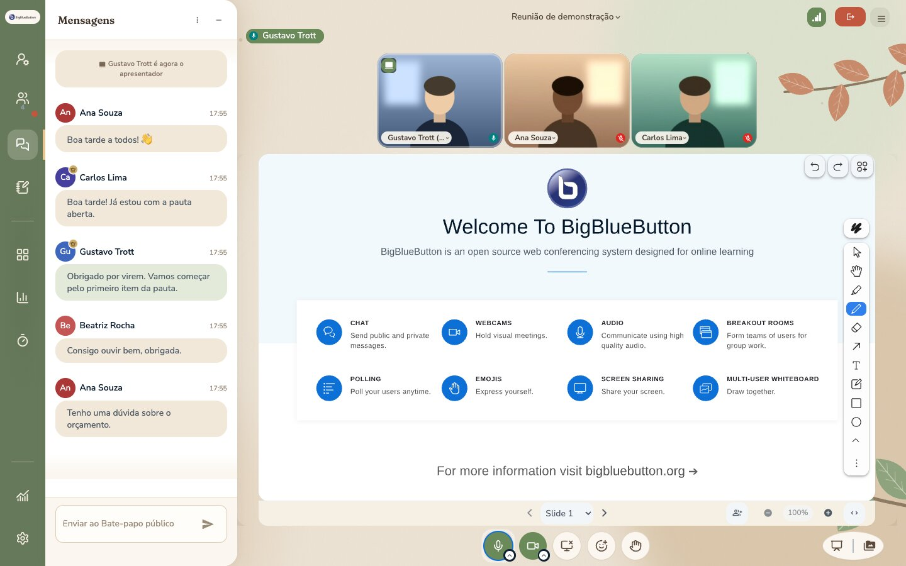
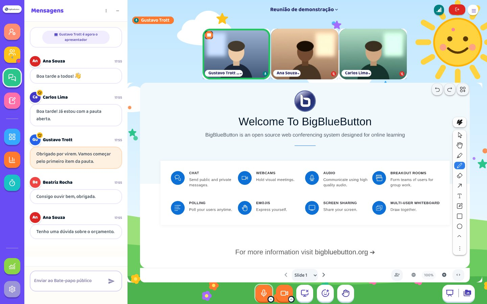
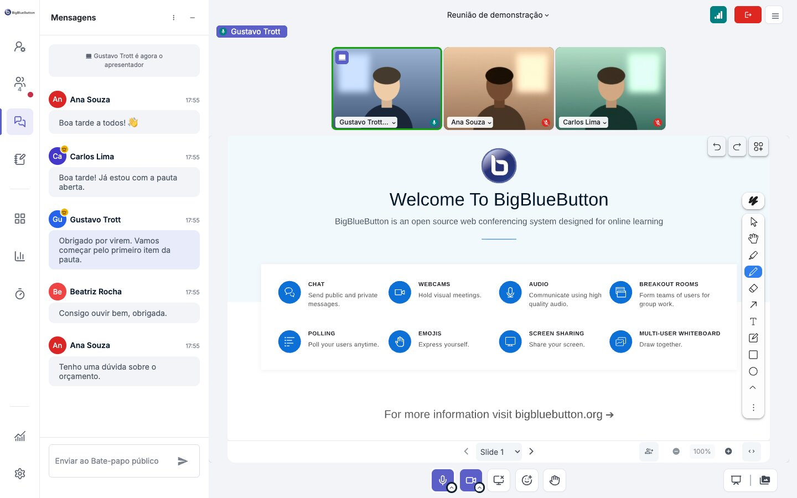
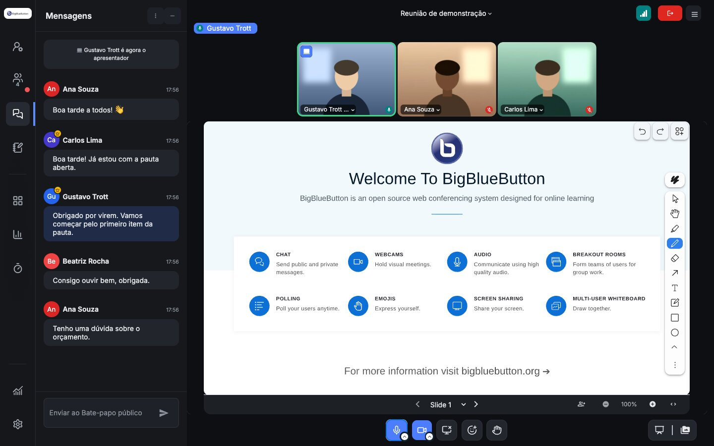
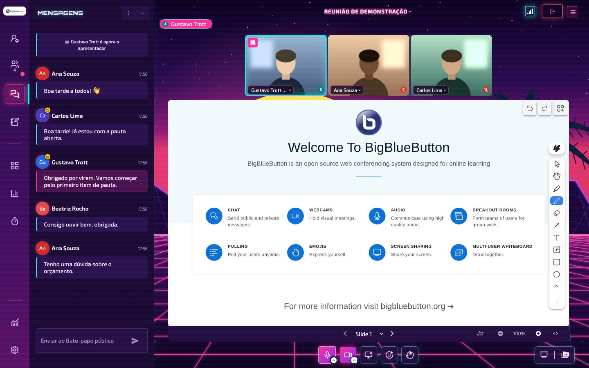
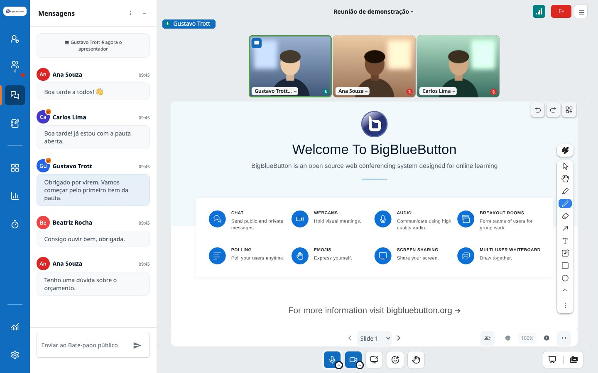
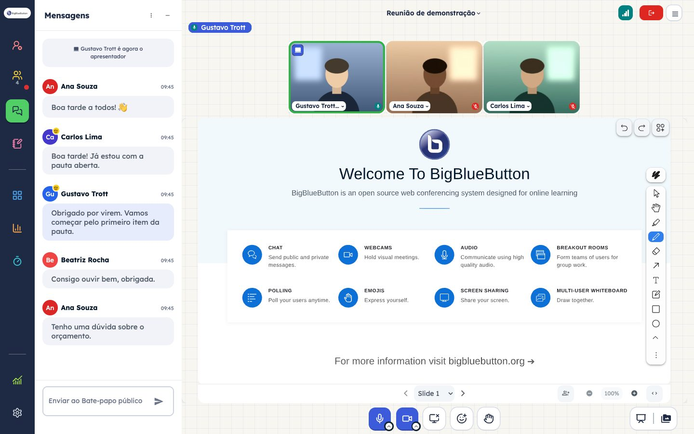
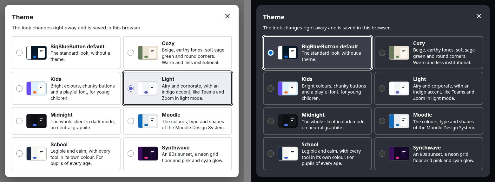

# BigBlueButton themes

One plugin for the BigBlueButton 4.0 HTML5 client with seven themes and a theme picker, so every participant can choose their own look. Each theme changes colours, shapes, fonts and the background, and keeps the same layout fixes:

- full-height icon bar and sidebar
- [Lucide](https://lucide.dev) icons
- round avatars with a moderator crown and a presenter badge
- cameras that fill their tile, with a green ring on whoever speaks
- a keyboard focus ring, and reduced motion when the system asks for it

The themes are pure CSS and share one base derived from [bbb-plugin-flat-theme](https://github.com/gustavotrott/bbb-plugin-flat-theme). They come two ways:

- **As a plugin** (`pluginManifests`), the default: all seven themes and a [theme picker](#the-theme-picker) in the client.
- **As a plain stylesheet** (`customStyleUrl`): one static `theme.css` per theme, with the icons and backgrounds inlined, if you would rather not run a plugin. See [Use a theme as a custom style](#use-a-theme-as-a-custom-style-css-only).

> **The plugin requires BigBlueButton 4.0.1 or later** (the static `bbb-*` classes). For 4.0.0, use a theme as a [custom style](#use-a-theme-as-a-custom-style-css-only).

<table>
<tr><td width="50%"><a href="#cozy"><br><b>Cozy</b></a></td><td width="50%"><a href="#kids"><br><b>Kids</b></a></td></tr>
<tr><td width="50%"><a href="#light"><br><b>Light</b></a></td><td width="50%"><a href="#midnight"><br><b>Midnight</b></a></td></tr>
<tr><td width="50%"><a href="#synthwave"><br><b>Synthwave</b></a></td><td width="50%"><a href="#moodle"><br><b>Moodle</b></a></td></tr>
<tr><td width="50%"><a href="#school-k-12"><br><b>School (K-12)</b></a></td><td></td></tr>
</table>

_Camera images in the screenshots are illustrations. The fonts load from Google Fonts; without internet access the client falls back to its own font._

## The theme picker

The plugin adds an entry to the client's options menu (the "more options" menu), called "Theme" ("Design" in German, "Tema" in Spanish and Portuguese, "Thème" in French). It opens a dialog with "BigBlueButton default" (the client's own look) and every theme the server offers, each with its name, colours and a short description. The dialog follows the client's language (English, German, Spanish, French or Brazilian Portuguese, English for the rest) and works with the keyboard: arrow keys pick a theme, Escape closes it.



The choice applies at once. It is saved in the browser (`localStorage`), not on the server, so it holds for every meeting on that server in that browser, breakout rooms included, until the user picks another one. In another browser or on another device the user starts again from the server's default. Only the theme id is stored, nothing about the user.

Who sees what: a user who picked a theme sees that one, as long as the server still offers it; everyone else sees the server's `defaultTheme`, and without one the plain BigBlueButton look. With `allowUserChoice: false` there is no picker and everyone sees `defaultTheme`. See [Settings](#settings).

**Dark mode.** BigBlueButton's own dark mode (Settings, "Dark mode") restyles the whole page, and so does a theme, so the two don't mix: while a theme is active, the dark mode is paused, and the dialog says so. "BigBlueButton default" shows the dark mode again. Turning the dark mode on while a light theme is active switches to "BigBlueButton default" (and saves that choice), so the dark mode shows. Midnight and Synthwave stay, since they are dark already, and so does every theme when `allowUserChoice` is `false`. The plugin never changes the dark mode setting itself.

A few parts of the client switch to their dark variant on their own, without the dark mode's stylesheets, so they stay dark while a theme pauses the dark mode: the custom logo (when the server has a separate dark logo), the emoji picker in the chat and the reactions, a few labels and icons, and on phones the colour of the browser bar.

## Try it without installing

The plugin is hosted on GitHub Pages. Pass its manifest on the `create` call of a meeting, and that meeting loads it with nothing installed on the server:

```text
pluginManifests=[{"url":"https://gustavotrott.github.io/bbb-plugin-themes/manifest.json"}]
```

Then pick a theme from the options menu in the meeting. You can try it from [API Mate](https://mconf.github.io/api-mate/) or your own integration (Moodle, Greenlight, Scalelite...).

The BigBlueButton server reads the manifest when the meeting is created, so it must reach `github.io`. The participants' browsers load the plugin from there too. The [settings](#settings) come from the server, so without them the meeting starts in the plain BigBlueButton look and the picker offers all seven themes. If the server already loads one of the 0.1.x theme plugins, both run in the meeting; see [Upgrading from 0.1.x](#upgrading-from-01x).

## Install on your server

These steps install from the latest [release](https://github.com/gustavotrott/bbb-plugin-themes/releases/latest).

1. Download the plugin into the plugins folder:

   ```bash
   curl -fsSL https://github.com/gustavotrott/bbb-plugin-themes/releases/latest/download/bbb-plugin-themes.tar.gz \
     | sudo tar xz --no-same-owner -C /var/www/bigbluebutton-default/assets/plugins
   ```

   This creates (or updates) the folder `bbb-plugin-themes/` with the plugin (`BbbPluginThemes.js`, `manifest.json`) and each theme's stylesheets in `<theme>/`.

2. Add the manifest to `pluginManifests` in `/etc/bigbluebutton/bbb-web.properties`. If the line already lists other plugins, add it to the list:

   ```properties
   pluginManifests=[{"url":"https://<your-server>/plugins/bbb-plugin-themes/manifest.json"}]
   ```

3. Restart bbb-web:

   ```bash
   sudo systemctl restart bbb-web
   ```

Meetings created from then on have the theme picker. To set a default theme or offer fewer themes, see [Settings](#settings). To update, run step 1 again. No restart is needed.

You can skip the download and put the GitHub Pages manifest in `bbb-web.properties` instead. The plugin then always follows the latest version on `main`.

## Settings

All settings are optional. Set them in `/etc/bigbluebutton/bbb-html5.yml`, in the plugin's entry under `public.plugins` (if the file already has a `public:` section, add `plugins:` to it):

```yaml
public:
  plugins:
    - name: BbbPluginThemes
      settings:
        defaultTheme: moodle
        themes: moodle,light,midnight
        allowUserChoice: true
```

| Setting | Default | What it does |
|---|---|---|
| `defaultTheme` | `none` | The theme for everyone who has not picked one: a theme id (`cozy`, `kids`, `light`, `midnight`, `synthwave`, `moodle`, `school`) or `none` for the plain BigBlueButton look. |
| `themes` | all | The themes offered in the picker, as comma-separated ids. A YAML list works too. The `defaultTheme` is always offered. Unknown ids are skipped, with a warning in the browser console; if none is known, all themes are offered. |
| `allowUserChoice` | `true` | `false` hides the picker, and everyone gets `defaultTheme`. |

Then restart BigBlueButton (`sudo bbb-conf --restart`). The client settings are stored per meeting by akka-apps, which only reads `bbb-html5.yml` on startup. Meetings created from then on use the new settings.

## Upgrading from 0.1.x

Version 0.1.x had one plugin per theme, each in its own `bbb-plugin-<theme>-theme` folder. 0.2.0 replaces them with one plugin:

1. Install it as in [Install on your server](#install-on-your-server), step 1. It goes into its own folder, `bbb-plugin-themes/`, next to the old ones.
2. In `pluginManifests` in `bbb-web.properties`, replace the old theme manifests with `https://<your-server>/plugins/bbb-plugin-themes/manifest.json`. Do the same where your integration passes `pluginManifests` on `create`. The per-theme manifests on GitHub Pages (`.../bbb-plugin-themes/<theme>/manifest.json`) are gone; use `https://gustavotrott.github.io/bbb-plugin-themes/manifest.json`.
3. To keep the theme you had, make it the default in [Settings](#settings) (for example `defaultTheme: moodle`), and set `allowUserChoice: false` if nobody should change it. Without a default, meetings start in the plain BigBlueButton look.
4. Restart BigBlueButton (`sudo bbb-conf --restart`).
5. Remove the old folders:

   ```bash
   sudo rm -rf /var/www/bigbluebutton-default/assets/plugins/bbb-plugin-{cozy,kids,light,midnight,synthwave,moodle,school}-theme
   ```

The stylesheet URLs on GitHub Pages are unchanged. On your own server only the folder changes, from `plugins/bbb-plugin-<theme>-theme/` to `plugins/bbb-plugin-themes/<theme>/`: if `customStyleUrl` points into an old folder, change it before step 5.

## Use a theme as a custom style (CSS only)

The build also writes `dist/<theme>/theme.css`: the same theme as one static stylesheet, with the icons and backgrounds inlined as data URIs. The client adds it as a `<link rel="stylesheet">`, so nothing runs besides the CSS. Use the plugin or the stylesheet, not both, and only one theme at a time.

Pick the stylesheet for your BigBlueButton version (here for `moodle`; swap in any theme):

| BigBlueButton | Stylesheet |
|---|---|
| 4.0.3 or later (with [#26415](https://github.com/bigbluebutton/bigbluebutton/pull/26415)) | `https://gustavotrott.github.io/bbb-plugin-themes/moodle/4.0.3/theme.css` |
| 4.0.1 and 4.0.2 | `https://gustavotrott.github.io/bbb-plugin-themes/moodle/4.0.1/theme.css` |
| 4.0.0 | `https://gustavotrott.github.io/bbb-plugin-themes/moodle/4.0.0/theme.css` |

`https://gustavotrott.github.io/bbb-plugin-themes/<theme>/theme.css` always follows the newest version on `main`. The release tarball has the stylesheets next to the plugin, in `<theme>/`.

The 4.0.0 and 4.0.1 stylesheets are frozen in [`versions/`](versions): new changes only go to the newest version. The 4.0.0 ones reach the client through the `data-test` attributes and ids that 4.0.0 already had, so a few details need a newer client: the presenter badge in the user list, the color of your own chat messages, the ring on the avatar of whoever speaks and the unread dot on the icon bar. The plugin itself still needs 4.0.1.

**For one user**, pass it on the `join` call:

```text
userdata-bbb_custom_style_url=https://gustavotrott.github.io/bbb-plugin-themes/moodle/theme.css
```

**For the whole server**, host it yourself (or use the GitHub Pages URL):

1. Download the release as in step 1 of [Install on your server](#install-on-your-server). The folder `bbb-plugin-themes/` now holds `moodle/theme.css` (newest version) and `moodle/<version>/theme.css` for each version in the table above, and the same for every other theme. You don't have to add the plugin to `pluginManifests`.

2. Set `public.app.customStyleUrl` in `/etc/bigbluebutton/bbb-html5.yml`:

   ```yaml
   public:
     app:
       customStyleUrl: https://<your-server>/plugins/bbb-plugin-themes/moodle/4.0.1/theme.css   # the folder for your version
   ```

3. Restart BigBlueButton (`sudo bbb-conf --restart`). The client settings are stored per meeting by akka-apps, which only reads `bbb-html5.yml` on startup.

Meetings created from then on load the stylesheet. To update, run step 1 again.

## Themes

### Cozy

Beige, earthy tones, soft sage green and round corners: a warm, less institutional look.


- Linen stage with soft blots of color and a few branches near the corners (`themes/cozy/scene.svg`).
- Sage icon bar, cream panels, oat and sage chat bubbles, terracotta for "muted" and "leave".
- Round "pebble" buttons in the action bar, 16px corners, a sidebar that reads as a card on the table.
- Panel titles in Fraunces (a soft serif), text in Nunito Sans (Google Fonts).
- Avatar colors toned down to earthy hues.

**Best for:** Community and condo meetings, audiences that find "office" screens cold.

Id: `cozy`

Stylesheet: `https://gustavotrott.github.io/bbb-plugin-themes/cozy/<4.0.0|4.0.1|4.0.3>/theme.css`

### Kids

Bright colors, chunky round buttons and a playful font, for classes with children.


- A sky with clouds, a smiling sun and hills with flowers (`themes/kids/scene.svg`).
- Every icon in the icon bar is a colored block (yellow users, green chat, pink notes...), so children can find "the green one".
- 50px chunky action bar buttons that press down, orange accent.
- Avatars as stickers with a white border, cameras as polaroid frames.
- Baloo 2, a rounded and bold font (Google Fonts), and a little bounce when menus open.

**Best for:** Preschool and the first school years (up to about 9).

Id: `kids`

Stylesheet: `https://gustavotrott.github.io/bbb-plugin-themes/kids/<4.0.0|4.0.1|4.0.3>/theme.css`

### Light

An airy, corporate light layout with an indigo accent, like Microsoft Teams and Zoom in light mode.


- White icon bar with dark icons and an indigo marker on the left of the active item.
- Light gray stage, white cards with soft shadows for the presentation and cameras.
- Indigo for active buttons, switches and confirm buttons; crisp 8px corners.
- Inter (Google Fonts).

**Best for:** Companies and formal meetings, rooms with a projector or lots of light.

Id: `light`

Stylesheet: `https://gustavotrott.github.io/bbb-plugin-themes/light/<4.0.0|4.0.1|4.0.3>/theme.css`

### Midnight

The whole client in dark mode, like Discord, Zoom and Slack at night.


- Graphite icon bar, panels, menus, modals and notifications (`shared/dark.css` repaints what the client draws in fixed light colors).
- Calm blue accent, green for speaking, a soft red tile for "muted".
- Made for long evening meetings: no white surface left in the sidebar, menus or settings.
- Inter (Google Fonts).

**Best for:** Evening meetings, people who prefer dark mode.

Id: `midnight`

Stylesheet: `https://gustavotrott.github.io/bbb-plugin-themes/midnight/<4.0.0|4.0.1|4.0.3>/theme.css`

### Synthwave

An 80s sunset with a neon grid floor and pink/cyan glow (vaporwave / outrun), for fun meetings and events.


- A synthwave scene behind the stage: sunset sky with stars, striped sun, wireframe mountains, palms and the neon grid (`themes/synthwave/scene.svg`).
- Neon pink and purple icon bar, dark glass panels with cyan edges, glowing cameras and presentation.
- Orbitron for titles, Exo 2 for text (Google Fonts); faint CRT scanlines.
- Built on the same dark panels as Midnight (`shared/dark.css`).

**Best for:** Events, parties, game nights and demos.

Id: `synthwave`

Stylesheet: `https://gustavotrott.github.io/bbb-plugin-themes/synthwave/<4.0.0|4.0.1|4.0.3>/theme.css`

### Moodle

The colours, type and shapes of the [Moodle Design System](https://design.moodle.com), so a room opened from a Moodle course looks like part of the course.


- Icon bar in Moodle blue (`blue.500` #0F6CBF); the active item in `blue.700` with a brand-orange mark on the left.
- Light gray stage (`gray.200`), the presentation and cameras as white cards with the system's small shadow.
- Secondary buttons white with a gray border like Moodle's `btn-secondary`; primary in blue, darker on hover.
- Chat: own messages in `blue.50`, others in `gray.100`.
- Noto Sans, the system's typeface; radius tokens 6/8/12 px; a blue focus ring that is always visible.
- The Moodle Design System primitives are at the top of `themes/moodle/theme.css` as `--mds-*` variables.

**Best for:** Rooms opened from a Moodle course.

Id: `moodle`

Stylesheet: `https://gustavotrott.github.io/bbb-plugin-themes/moodle/<4.0.0|4.0.1|4.0.3>/theme.css`

### School (K-12)

Made for K-12 classes: legible and calm, with every tool in its own colour, friendly for young pupils without looking childish to teenagers.


- Lexend, a typeface designed to make reading easier, slightly larger than the client's default.
- Each tool in the icon bar has its colour (people yellow, chat green, notes pink, polls orange...); the active one becomes a block of that colour.
- Raised hands in a yellow row the teacher can't miss.
- 46px action buttons that press down; a yellow keyboard focus ring.
- A light stage on graph paper, with white cards for the presentation and cameras.

**Best for:** Whole K-12 schools: children, teenagers and teachers on the same platform.

Id: `school`

Stylesheet: `https://gustavotrott.github.io/bbb-plugin-themes/school/<4.0.0|4.0.1|4.0.3>/theme.css`

## Build from source

```bash
npm ci
npm run build-bundle               # the plugin and every stylesheet, into dist/
npm run build-css                  # only the stylesheets
node scripts/css.js cozy,school    # only some stylesheets
node scripts/site.js               # the GitHub Pages site, into site/ (after build-bundle)
```

`dist/` then holds `BbbPluginThemes.js`, `manifest.json` and a folder per theme with `theme.css` and the frozen stylesheets for older versions, copied from `versions/<theme>/`. Copy its contents to `/var/www/bigbluebutton-default/assets/plugins/bbb-plugin-themes/` and follow steps 2 and 3 of [Install on your server](#install-on-your-server).

## Layout

| Path | What it holds |
|---|---|
| `src/` | The plugin: applies the theme, adds the theme picker and pauses the client's dark mode while a theme is active |
| `docs/` | Images for this README |
| `manifest.json` | Plugin manifest |
| `shared/base.css` | Shared base (layout, icons, accessibility), with every colour and corner as a `--theme-*` variable |
| `shared/dark.css` | Dark panels, menus, modals and notifications (themes with `"dark": true`: Midnight and Synthwave) |
| `shared/icons/` | Lucide icons, inlined into the bundle |
| `themes/<id>/theme.json` | Name, picker colours, `dark`, and the description in each language. The folder name is the theme id |
| `themes/<id>/theme.css` | The theme: palette (`:root` variables) and its own look |
| `themes/<id>/scene.svg` | Background illustration (Cozy, Kids, Synthwave). Replace it with any image and rebuild |
| `versions/<id>/<version>/` | Stylesheets frozen for older BigBlueButton versions |

To make a new theme, copy a folder in `themes/` (its new name is the theme id), edit its `theme.json` and set the variables at the top of its `theme.css`. Then rebuild.

## Releases

Every push to `main` publishes `dist/` (the plugin and the stylesheets) on GitHub Pages. Pushing a `v*` tag builds everything and attaches `bbb-plugin-themes.tar.gz` to a GitHub release: the contents of `dist/` in one folder, `bbb-plugin-themes/`. The tag must match the version in `package.json` and `manifest.json` (for `v0.2.0`, both say `0.2.0`); the build stops if it does not.

## License

MIT, see [LICENSE](LICENSE). Icons, including the palette icon of the theme picker, are from [Lucide](https://lucide.dev), ISC license, see [shared/icons/LICENSE](shared/icons/LICENSE).
